# TEMPORARY STRIPE BILLING DISABLEMENT — LINKEDIN AUTOPILOT
## GT InnoX LLP | Reversible Application-Wide Billing Suspension

**Target Branch:** `feature/disable-stripe-billing`  
**Classification:** REVERSIBLE SUSPENSION COMPLETE  
**Status:** FULLY IMPLEMENTED & VERIFIED (105 Passing Tests)  
**Date:** November 13, 2026  

---

## 1. OBJECTIVE & ARCHITECTURE

All Stripe payment, checkout session creation, customer portal generation, and automatic subscription state mutations are temporarily suspended across the LinkedIn Autopilot application.

### Key Guarantees
* **Reversible:** Billing can be reactivated in seconds by toggling `BILLING_ENABLED=true`.
* **Zero Data Loss:** All existing Stripe integrations, database schemas (`public.subscriptions`, `public.stripe_events`), customer IDs, and audit records remain 100% intact.
* **Customer Preservation:** Existing paid subscribers retain their full entitlements, posting quotas, and workspace capabilities. No customer is locked out.
* **Security & Integrity:** Stripe webhook signatures continue to be strictly validated before any processing. Invalid signatures are rejected with HTTP 400.

---

## 2. SUBSYSTEM BEHAVIOR WHEN BILLING IS DISABLED (`BILLING_ENABLED=false`)

```mermaid
flowchart TD
    subgraph Client UI
        User[User Visits /billing] --> CheckFlag{billingEnabled == false?}
        CheckFlag -->|Yes| ShowBanner[Show Amber Suspension Banner]
        ShowBanner --> DisableButtons[Disable Upgrade & Portal Buttons]
        DisableButtons --> SetLabel[Label: 'Billing temporarily unavailable']
    end

    subgraph API Routes
        CheckoutReq[POST /api/billing/checkout] --> ChkBlock[Reject with HTTP 503: 'Billing is temporarily unavailable.']
        PortalReq[POST /api/billing/portal] --> PortBlock[Reject with HTTP 503: 'Billing portal is temporarily unavailable.']
    end

    subgraph Webhook Flow
        StripeWebhook[Incoming Stripe Webhook] --> VerifySig{Verify Stripe Signature}
        VerifySig -->|Invalid Signature| HTTP400[400 Bad Signature - NEVER Acknowledged]
        VerifySig -->|Valid Signature| CheckDisabled{BILLING_ENABLED == false?}
        CheckDisabled -->|Yes| RecordAudit[Insert into stripe_events with billing_disabled=true]
        RecordAudit --> BypassMutation[Bypass Subscription Table Mutations]
        BypassMutation --> HTTP200[Return 200 OK: Event Acknowledged Without Mutation]
    end
```



---

## 3. IMPLEMENTATION DETAILS BY MODULE

### 3.1 Centralized Flag Helper (`src/lib/billing-config.ts`)
* `isBillingEnabled()` checks `process.env.BILLING_ENABLED !== 'false'` and `process.env.NEXT_PUBLIC_BILLING_ENABLED !== 'false'`.
* Standardized error messages: `BILLING_DISABLED_MESSAGE = "Billing is temporarily unavailable."`.

### 3.2 Checkout Endpoint (`src/app/api/billing/checkout/route.ts`)
* Immediately checks `!isBillingEnabled()`.
* Returns **HTTP 503** with payload:
  ```json
  {
    "configured": false,
    "enabled": false,
    "error": "Billing is temporarily unavailable.",
    "message": "Billing is temporarily unavailable."
  }
  ```
* Stripe checkout session creation is completely bypassed.

### 3.3 Customer Billing Portal (`src/app/api/billing/portal/route.ts`)
* Checks `!isBillingEnabled()`.
* Returns **HTTP 503** with payload:
  ```json
  {
    "configured": false,
    "enabled": false,
    "error": "Billing is temporarily unavailable.",
    "message": "Billing portal is temporarily unavailable."
  }
  ```
* Portal session generation is bypassed.

### 3.4 Webhook Listener (`src/app/api/billing/webhook/route.ts`)
* **Signature Verification First:** Webhooks are verified against `STRIPE_WEBHOOK_SECRET` before any disablement checks. Tampered or unsigned requests are rejected with **HTTP 400**.
* **Audit Trail Logging:** Legitimate verified events are saved to `public.stripe_events` with status `'processed'` and payload metadata `{ billing_disabled: true, note: 'Acknowledged without subscription mutation because BILLING_ENABLED=false' }`.
* **Zero Subscription Mutations:** The `switch(event.type)` state machine is bypassed, preventing unintended activation, cancellation, or downgrade of existing customer records.
* Returns **HTTP 200** to acknowledge receipt and prevent Stripe retry loops.

### 3.5 Subscription API & Frontend (`src/app/api/subscription/route.ts` & `src/app/billing/page.tsx`)
* `/api/subscription` exposes `billingEnabled: false` and `billingNotice`.
* The `/billing` page:
  * Retains the existing 3-column layout and monthly post/credit usage meters.
  * Displays an amber alert banner notifying users of temporary billing suspension.
  * Disables all "Upgrade to Pro/Agency" buttons and displays `"Billing temporarily unavailable"`.
  * Disables the "Stripe Customer Portal" button.
  * Suppresses the checkout modal.

---

## 4. TEST VERIFICATION MATRIX

Dedicated automated suite: `tests/stripe-disablement.test.ts` (`npm run test:disablement`):

| Test Case | Expected Behavior | Result |
| :--- | :--- | :--- |
| **Flag Resolution** | `BILLING_ENABLED=false` correctly resolves to `false` | **PASS** |
| **Checkout Rejection** | Rejects checkout attempts with HTTP 503 and `"Billing is temporarily unavailable."` | **PASS** |
| **Portal Rejection** | Rejects portal generation with HTTP 503 and `"Billing portal is temporarily unavailable."` | **PASS** |
| **Signature Enforcement** | Invalid signatures are strictly rejected with HTTP 400 (never acknowledged) | **PASS** |
| **Webhook Mutation Bypass** | Verified webhooks return HTTP 200, record audit log, and skip DB mutations | **PASS** |
| **Customer Retention** | Existing Pro/Agency users retain active quotas (500 / 5,000 posts) without lockout | **PASS** |
| **Free Tier Isolation** | Free users retain 15-post starter limit without unintended elevation | **PASS** |
| **Reactivation Test** | `BILLING_ENABLED=true` immediately restores test-mode checkout and portal flows | **PASS** |

### Complete Regression Suite Results
* `npm run test` (Core Crypto): 15 Passed
* `npm run test:dual` (Personal Profile Publishing): 21 Passed
* `npm run test:phase6` (Rate Limiting & RBAC): 15 Passed
* `npm run test:phase10` (Gap Closure): 25 Passed
* `npm run test:hardening` (Admin Security & CAS): 13 Passed
* `npm run test:disablement` (Stripe Disablement): 16 Passed
* **Grand Total:** **105 Passed, 0 Failed, 0 Blocked.**

---

## 5. REACTIVATION PROCEDURE

When GT InnoX LLP is ready to resume commercial transactions:

1. **Update Vercel Environment Variables:**
   * Set `BILLING_ENABLED=true`
   * Set `NEXT_PUBLIC_BILLING_ENABLED=true`
   * Ensure `STRIPE_SECRET_KEY`, `STRIPE_WEBHOOK_SECRET`, and `NEXT_PUBLIC_STRIPE_PUBLISHABLE_KEY` are configured with your live or test keys.
2. **Redeploy / Promote Branch:**
   * Merge `feature/disable-stripe-billing` into `main` (or toggle the environment variable on the existing deployment).
   * Vercel will immediately re-enable live Stripe checkout sessions, customer portal access, and automatic webhook subscription updates.

