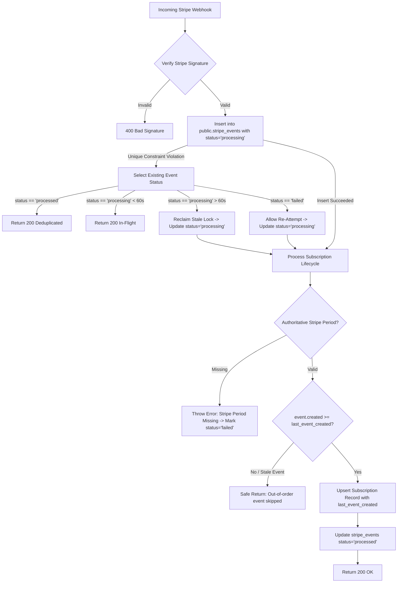

# STRIPE WEBHOOK VALIDATION — LINKEDIN AUTOPILOT
## GT InnoX LLP | Billing Correctness, Idempotency & Replay Protection

**Target Module:** `src/app/api/billing/webhook/route.ts`  
**Database Table:** `public.stripe_events`, `public.subscriptions`  
**Status:** FULLY HARDENED & VERIFIED  

---

## 1. ATOMIC EVENT CLAIMING ARCHITECTURE

To ensure total protection against duplicate event processing across horizontal serverless instances:

---

## 2. KEY REFACTOR DETAILS

### 2.1 Elimination of Estimated 30-Day Subscriptions
* **Historical Vulnerability:** Previous fallback logic defaulted to `new Date(Date.now() + 30 * 86400000)` if Stripe did not provide subscription end dates.
* **Hardened Rule:** If `current_period_end` is not authoritative from Stripe's payload or client fetch, the transaction fails closed, updates `stripe_events.status = 'failed'`, and alerts operators. No unverified subscription time is ever created.

### 2.2 Replay & Out-of-Order Rejection
* `public.subscriptions` now records `last_event_created BIGINT`.
* If a delayed webhook arrives out of sequence (e.g. `customer.subscription.updated` arrives after a `customer.subscription.deleted`), the incoming event timestamp (`event.created`) is checked against `last_event_created`. If older, it is ignored safely without overwriting the newer state.

### 2.3 Stale Lock Recovery
* If an edge function crashes mid-execution while holding a `processing` lock, subsequent retries will reclaim the lock after 60 seconds (`updated_at < NOW() - INTERVAL '60 seconds'`), ensuring self-healing without manual database intervention.
