# Multi-User Personal LinkedIn Publishing Root Cause Fix Report

**Company:** GT InnoX LLP  
**Product:** LinkedIn Autopilot SaaS  
**Repository:** `https://github.com/tejasrmap/linkedin-autopilot`  
**Production URL:** `https://autopilot.gtinnox.in`  
**Branch:** `fix/multi-user-publishing-root-cause`  
**Base Commit:** `17169aab6b1287e302bf23ae9c1049c5aaf09e6d` (PR #12 merge)  
**Date:** 15 November 2026  
**Status:** FULLY IMPLEMENTED & VERIFIED (0 Failures Across All 138 Tests)

---

## 1. Executive Summary

Following a deep-dive investigation documented in `MULTI_USER_PUBLISHING_INVESTIGATION_REPORT.md`, the failure preventing non-founder users from publishing to personal LinkedIn profiles was isolated to an architectural self-lockout race condition in the "Publish Now" route handler, paired with false-positive UI success reporting, comma-delimited OAuth scope parsing bugs, and queued-job scheduler starvation.

The core underlying systems (LinkedIn Developer permissions, AES-256-GCM token encryption/decryption, user identity resolution, and PostgreSQL multi-tenant RLS isolation) were empirically proven fully functional.

This corrective patch resolves the immediate self-lockout, eliminates false UI successes, reconciles orphaned queued jobs during stale reclamation, hardens OAuth scope parsing, and preserves workspace multi-tenancy. All 138 tests across 6 test suites passed with 0 failures, 0 TypeScript type errors, 0 ESLint warnings, and a 100% clean Next.js production build across all 45 routes.

---

## 2. Root Cause & Code Changes

### A. Publish Now Self-Lockout Race Condition
- **Problem:** When users clicked "Publish Now" in `/composer`, `src/app/api/posts/route.ts` pre-emptively inserted posts with `status = 'processing'`. `schedulePostPublishJob()` then immediately called `executePublishPipeline()`. In turn, `executePublishPipeline()` called the atomic lease RPC `claim_post_for_publishing()`. Because the post was already in `status = 'processing'` with `updated_at = now()`, `claim_post_for_publishing()` rejected the claim as `already_processing_or_completed` (it only claims `draft`, `scheduled`, `approved`, or stale `processing > 5m`). The publishing pipeline aborted before ever calling LinkedIn.
- **Fix in `src/app/api/posts/route.ts` & `src/lib/queue/publisher.ts`:**
  - `src/app/api/posts/route.ts`: Sets `initialStatus = 'draft'` for immediate publishing rather than `'processing'`.
  - `src/lib/queue/publisher.ts`: In `schedulePostPublishJob()`, for `delayMs <= 0` (Publish Now), it no longer pre-emptively sets `posts.status = 'processing'`. It leaves post status in `draft` and inserts `scheduled_jobs` with `status: 'scheduled'`.
  - `claim_post_for_publishing()` now cleanly transitions `draft -> processing` with full atomic lease ownership, UUID claim token assignment, and 300-second lease expiration.

### B. False-Positive UI Success Reporting
- **Problem:** `POST /api/posts` returned HTTP 200 with `{ published: true }` regardless of whether `scheduleResult.success` was true or false. Users were shown a celebratory toast (*"Post published successfully to LinkedIn! 🎉"*) even when publication was completely rejected.
- **Fix in `src/app/api/posts/route.ts` & `src/app/composer/page.tsx`:**
  - `src/app/api/posts/route.ts`: For `publishNow: true`, checks `scheduleResult.success`. If `!scheduleResult.success`, returns HTTP 400 with `{ published: false, error: scheduleResult.error }`. Only returns HTTP 200 with `{ published: true }` when publication genuinely succeeds.
  - `src/app/composer/page.tsx`: Explicitly checks `data.published`. If false, displays `toast.error(data.error)` and directs the user to the draft tab so posts are never lost.

### C. Stale Queued-Job Scheduler Starvation
- **Problem:** When a post failed or was abandoned, `schedulePostPublishJob()` had created a `scheduled_jobs` record with `status: 'queued'`. When the cron stale-lock recovery ran 5 minutes later, it only updated `scheduled_jobs WHERE status = 'processing'`. The cron poller only searches `WHERE status = 'scheduled'`. Consequently, the job remained trapped in `queued` indefinitely.
- **Fix in `src/app/api/cron/publish/route.ts`:**
  - Updated stale-lock cleaner to reconcile both `processing` and `queued` job states:
    ```typescript
    await supabase
      .from('scheduled_jobs')
      .update({
        status: 'scheduled',
        claim_token: null,
        lease_expires_at: null,
        updated_at: nowIso,
      })
      .eq('post_id', stale.id)
      .in('status', ['processing', 'queued']);
    ```

### D. Comma-Separated OAuth Scope Parsing
- **Problem:** LinkedIn's OAuth token endpoint returns `tokenData.scope` as `"email,openid,profile,w_member_social"`. Splitting by space (`tokenData.scope.split(' ')`) created a single array element `["email,openid,profile,w_member_social"]`. Array checks like `.includes('w_member_social')` evaluated to `false`. Furthermore, if `tokenData.scope` was absent, the code fell back to assuming all permissions.
- **Fix in `src/app/api/linkedin/callback/route.ts` & `src/lib/queue/publisher.ts`:**
  - Implemented regex split `.split(/[\s,]+/).map(s => s.trim()).filter(Boolean)` in both callback handler and publisher pipeline.
  - In `src/app/api/linkedin/callback/route.ts`, assigns `connection_status: 'active'` only when `scopes.includes('w_member_social')` is verified; otherwise sets `'limited_permissions'`.
  - In `src/lib/queue/publisher.ts`, verifies required posting scopes for personal member accounts before calling LinkedIn.

---

## 3. Summary of Changed Files

| File | Change Type | Description |
|---|---|---|
| `src/app/api/posts/route.ts` | Modified | Sets `initialStatus = 'draft'` on Publish Now; returns HTTP 400 with `{ published: false }` if publishing fails; returns HTTP 200 with `{ published: true }` on genuine success. |
| `src/lib/queue/publisher.ts` | Modified | Removes pre-emptive `processing` status update in `schedulePostPublishJob()`; inserts `scheduled_jobs` as `scheduled`; validates normalized scopes before publish. |
| `src/app/api/cron/publish/route.ts` | Modified | Reconciles stale `scheduled_jobs` records from both `processing` and `queued` states to `scheduled`. |
| `src/app/api/linkedin/callback/route.ts` | Modified | Parses comma-separated and whitespace-separated OAuth scopes; sets `connection_status` to `'limited_permissions'` if `w_member_social` is absent. |
| `src/app/composer/page.tsx` | Modified | Checks `data.published` before toasting success; displays error toast and navigates to drafts if publication fails. |
| `src/lib/supabase/admin.ts` | Modified | Synchronizes mock `scheduled_jobs` states during `claim_post_for_publishing` RPC in test harness. |
| `tests/serverless-scheduler.test.ts` | Modified | Added 7 regression tests covering Publish Now atomic claiming, failed claim rejection, queued job recovery, future scheduling preservation, multi-tenant isolation, and OAuth scope parsing. |
| `MULTI_USER_PUBLISHING_INVESTIGATION_REPORT.md` | Added | Full read-only root-cause investigation report and empirical evidence. |
| `MULTI_USER_PUBLISHING_FIX_REPORT.md` | Added | This comprehensive fix report and verification deliverable. |

---

## 4. State Transition Lifecycle (Before vs After)

```mermaid
stateDiagram-v2
    direction TB

    state "BEFORE: Self-Lockout & Starvation" as Before {
        [*] --> Draft_Old: User clicks "Publish Now"
        Draft_Old --> Processing_Premature: POST /api/posts sets status = 'processing'
        Processing_Premature --> Claim_Old: executePublishPipeline calls claim_post_for_publishing
        Claim_Old --> SelfLockout_Old: REJECTED (Already processing, 0s old)
        SelfLockout_Old --> Abandoned_Old: Pipeline aborts; LinkedIn never called
        Abandoned_Old --> UI_Lie_Old: UI reports "Published successfully! 🎉" (False Positive)
        Abandoned_Old --> QueuedTrap_Old: scheduled_jobs remains 'queued' permanently
    }

    state "AFTER: Atomic Lease Ownership & Accurate UI" as After {
        [*] --> Draft_New: User clicks "Publish Now"
        Draft_New --> Claim_New: Initial status = 'draft'; schedulePostPublishJob creates 'scheduled' job
        Claim_New --> Atomic_Processing: claim_post_for_publishing acquires UUID claim token & lease
        Atomic_Processing --> LinkedIn_Call: executePublishPipeline invokes LinkedIn REST API
        LinkedIn_Call --> Published_Success: HTTP 201 Created -> finalize_post_publishing marks 'published'
        Published_Success --> UI_Success: API returns HTTP 200 { published: true } -> UI toasts success
        LinkedIn_Call --> Retry_Backoff: Transient Failure -> handle_publishing_failure_and_retry
        Retry_Backoff --> UI_Error: API returns HTTP 400 { published: false } -> UI shows error & keeps post
    }
```



---

## 5. Automated Verification Results

All automated test suites, type checking, linting, and Next.js production compilation were executed.

### Test Suite Execution Summary

```
========================================================================================
Test Suite                                              Status    Passed    Failed
========================================================================================
Serverless Scheduler & Concurrency Suite (test:serverless) PASS       27         0
Real PostgreSQL Staging Integration Suite (test:postgres)   PASS       23         0
Stripe Disablement & Subscription Hardening (test:disablement) PASS   44         0
Worker Recovery & Heartbeat Telemetry (test:worker)         PASS       16         0
Security Hardening & Multi-Tenant Boundaries (test:hardening) PASS    13         0
Core Application Suite (test)                               PASS       15         0
----------------------------------------------------------------------------------------
Total Automated Tests                                       PASS      138         0
========================================================================================
TypeScript Type Checking (npx tsc --noEmit)                 PASS       0 errors
ESLint Code Quality (npm run lint)                          PASS       0 errors, 0 warnings
Next.js Production Build (npm run build)                    PASS       45 / 45 routes compiled
========================================================================================
```

---

## 6. Residual Risks & Operational Guidance

1. **LinkedIn Organization Pages:** Company/Organization page publishing remains untouched as required.
2. **Stripe Billing:** Billing remains disabled (`isBillingEnabled() === false`) with HTTP 503 fail-closed responses.
3. **Database Migrations:** No migration was executed or required; all changes operate within existing PostgreSQL schemas and RPC definitions.
4. **Pull Request Protocol:** Branch `fix/multi-user-publishing-root-cause` is ready for review and must NOT be merged without stakeholder approval.
