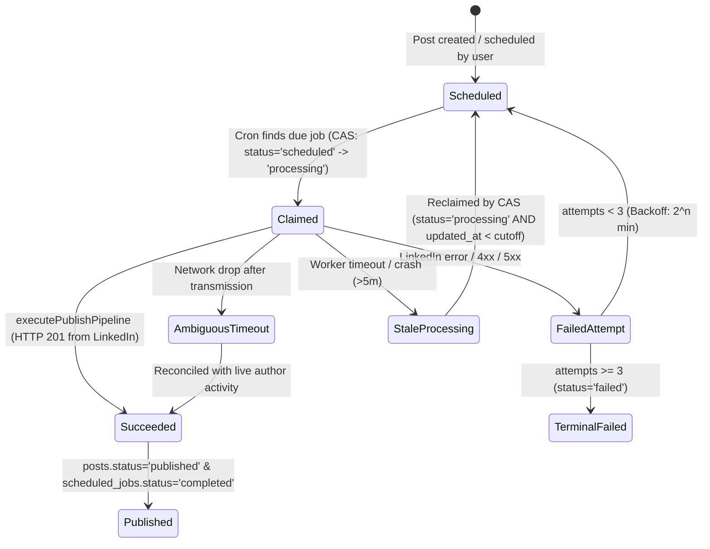

# SCHEDULER RELIABILITY REPORT — LINKEDIN AUTOPILOT
## GT InnoX LLP | Autonomous Engineering Mission

**Company:** GT InnoX LLP  
**Repository:** `https://github.com/tejasrmap/linkedin-autopilot`  
**Production URL:** `https://autopilot.gtinnox.in`  
**Date:** November 14, 2026  
**Active Architecture:** Supabase `pg_cron` + `pg_net` + Supabase Vault + Next.js Serverless Route (`/api/cron/publish`)  

---

## 1. Architecture Flow & State Machine



---

## 2. Reliability Hardening Measures

### A. Retry-State Consistency
- **Previous Hazard**: The publishing pipeline marked a post `failed` on LinkedIn errors while the cron retry block only checked for `processing`, causing orphan state splits where `posts.status = 'scheduled'` and `scheduled_jobs.status = 'failed'`.
- **Hardened State Machine**: In `src/app/api/cron/publish/route.ts`, retry updates to `scheduled_jobs` now condition on:
  ```typescript
  .update({
    status: 'scheduled',
    scheduled_at: retryAtIso,
    attempts: currentAttempts,
    last_error: publishRes.error,
    updated_at: nowIso,
  })
  .eq('id', job.id)
  .in('status', ['failed', 'processing']);
  ```
- Posts already marked `published` are **never** reopened because the post update is strictly conditioned on `in('status', ['failed', 'processing'])`.

### B. Concurrent Execution Safety
- Compare-And-Swap (CAS) state claiming ensures that when two cron triggers fire simultaneously for the same post, exactly one request claims the transition `scheduled -> processing`.
- Competing invocations receive an affected row count of 0 and cleanly exit without mutating the post.
- Stale lock reclamation rechecks both `status = 'processing'` AND `updated_at < staleThresholdIso` (5-minute cutoff) during the update. A newly started active execution that updated its timestamp $<5$ minutes ago cannot be stolen.

### C. Idempotency & Ambiguous LinkedIn Timeouts
- If LinkedIn API connectivity times out after request transmission, `executePublishPipeline` initiates an automated live reconciliation query against recent author shares (`reconcileRecentAuthorPost`).
- If the commentary snippet matches a recently published live LinkedIn post, the pipeline extracts the live `provider_post_id` (`urn:li:share:...`) and records `status: 'published'` without re-dispatching, guaranteeing that transient HTTP drops never produce duplicate publications.
